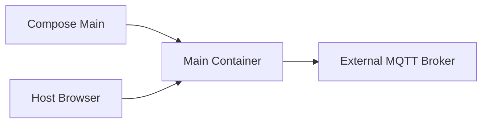

# Requirements

### Overview & Goals
Containerize the production Java service (`Main`) with a readable, repeatable Docker Compose setup that connects to the MQTT broker already running on the historical PC. `Main2` is a test-only entry point and is intentionally excluded.

### Scope
**In scope**
- Multi-stage Java image build from the existing Gradle project.
- `docker-compose.main.yml` for `Main` only.
- Container-safe YAML configuration overrides, HTTP port exposure, configurable external MQTT host/port, and application restart policy.
- Documentation for connecting to the pre-existing MQTT broker.
- Repeatable build, start, stop, logs, and smoke-test documentation.

**Out of scope**
- PostgreSQL, a combined multi-application stack, authentication, TLS, Kubernetes, or changes to Binance/MQTT business behavior.

### Functional Requirements
- `docker compose -f docker-compose.main.yml up --build` starts the Binance application and connects it to the configured external MQTT broker.
- `Main2` is not containerized or included in the Compose workflow.
- The application uses a configurable MQTT hostname/address rather than assuming `localhost`; the app remains alive if MQTT is temporarily unavailable.
- Host users can access the HTTP control API on a documented port and inspect application logs with Compose commands.
- Configuration remains YAML-based and can be overridden per stack without modifying the application resource defaults.
- Container shutdown propagates cleanly to the existing JVM shutdown hooks; the application restart policy applies to process/container failure rather than worker lifecycle commands.

# Technical Design

### Current Implementation
The project is a single Gradle Java module using `build.gradle.kts`, Jackson YAML, Eclipse Paho, the JDK WebSocket client, and native `HttpServer`. `Main.java` wires `PahoMqttPublisher`, `BinanceMarketWorker`, `ApplicationManager`, and `ControlHttpServer`. `Main2.java` is a test-only dummy entry point and is excluded from this Docker work. `ConfigLoader` accepts an external YAML path through `--config`, while the bundled `application.yml` currently points MQTT to `tcp://localhost:1883` and HTTP to `127.0.0.1:8080`.

`BinanceMarketWorker` keeps one reusable JDK `HttpClient`, reconnects generation-safely, publishes configured realtime/completed/logging topics, and does not require the broker to be available at startup. This behavior should remain unchanged; Dockerization supplies container-specific configuration and networking only.

### Key Decisions
- Use one shared application `Dockerfile` and one `docker-compose.main.yml`; do not containerize or include `Main2`.
- Use a lightweight JRE runtime image after a Gradle builder stage; run the packaged application as a non-root user where practical.
- Connect to the MQTT broker on the historical PC using a stack-specific YAML value such as `MQTT_HOST`/`MQTT_PORT` or an explicitly mounted configuration file; do not add any broker service.
- Mount the production YAML at runtime and invoke `java -jar app.jar --config /config/application.yml`, preserving the existing `ConfigLoader` contract.
- Expose the application HTTP port; expose an MQTT port only when host-side access to the existing broker requires it, not as a broker container port.
- Retain the worker’s asynchronous MQTT reconnect behavior because broker availability is external to the Compose lifecycle.

### Proposed Changes
Add a multi-stage `Dockerfile` that runs the Gradle wrapper to produce the application JAR, then copies the JAR and a Java runtime into a small runtime image. Add one production Compose file and a container-safe YAML configuration that changes only container concerns: external MQTT broker address, HTTP bind address, and client ID if needed.

Do not add Mosquitto configuration, broker volumes, broker health checks, or a second Compose stack. Document the required network reachability from the application container to the MQTT broker on the historical PC.

Add concise deployment documentation covering build/start commands for `Main`, external MQTT host configuration, HTTP checks (`/status` and `/live-updates`), application logs, shutdown, and cleanup. Add smoke validation that confirms the application starts, remains running, reaches the configured broker address, and exposes its HTTP API.

### File Structure
- Add `Dockerfile` for the shared multi-stage Java build/runtime image.
- Add `docker-compose.main.yml` for `Main` only, without an MQTT broker service.
- Add `docker/config/main/application.yml` with container-safe production overrides pointing to the external broker.
- Add `docker-compose.md` documenting external broker prerequisites, commands, ports, and smoke checks.
- Keep `src/main/java/nbgsmk/msr/Main.java` and `BinanceMarketWorker.java` behavior unchanged unless a small packaging-compatible adjustment is required; do not modify `Main2.java`.

### Architecture Diagram

### Risks
- Binding HTTP to `127.0.0.1` inside a container would make the API unreachable from the host; the production YAML must use `0.0.0.0`.
- Using `localhost` for MQTT would make the application connect to its own container; the external broker address must be configurable and reachable from the container network.
- Docker network routing, firewall rules, or broker bind settings may prevent access to a broker running in another container; document the required shared network or reachable host address.
- Image builds depend on downloading Gradle/Maven dependencies; document offline limitations and keep runtime startup independent of the build environment.

# Testing

### Validation Approach
Build the image with Docker Compose, start the production application, inspect its health and logs, and query the exposed HTTP API from the host. Run existing Gradle tests separately and perform smoke checks without requiring live Binance data beyond the worker’s normal reconnect behavior.

### Key Scenarios
- `docker compose -f docker-compose.main.yml config` renders a valid Compose configuration containing only the production application service.
- The image builds successfully and starts `Main` without a broker service in the Compose project.
- `GET /status` returns a valid response; `/start`, `/stop`, `/restart`, and `/live-updates` remain reachable.
- Application logs and status show that MQTT uses the configured external broker address rather than `localhost`, and the process remains alive while MQTT is unavailable or restarted.
- Stopping the Compose application triggers clean JVM shutdown handling.

### Edge Cases
- The external broker starts slowly, restarts after application startup, or is temporarily unavailable.
- The external configuration mount is absent, malformed, or contains an invalid broker host/port; startup reports a clear error.
- The application container cannot route to the broker because it is not on a shared Docker network or the broker address is unreachable.
- The host HTTP port is already occupied; Compose reports the binding failure clearly.

# Delivery Steps

### ✓ Stage 1: Add the production Java container image
The project produces a small runnable image for `Main`; `Main2` remains outside the Docker workflow.
- Add the multi-stage `Dockerfile` using the Gradle wrapper for the build stage and a compatible JRE runtime stage.
- Copy the built JAR into the runtime image and define a non-root runtime user where supported.
- Launch the packaged `nbgsmk.msr.Main` entry point with `--config /config/application.yml`.
- Verify the image builds and the production process starts without changing application code.

### ✓ Stage 2: Create the Compose stack for Main and the external historical-PC MQTT broker
The Binance application runs reproducibly with only its application container while connecting to the MQTT broker already running on the historical PC.
- Add `docker-compose.main.yml` with one application service, restart policy, HTTP port mapping, and configuration for reaching the historical-PC broker; do not define an MQTT broker service.
- Add the production container YAML override with `mqtt.broker` set to the externally reachable broker address and `http.host: 0.0.0.0`.
- Do not define Mosquitto, broker volumes, broker health checks, or `Main2` services.
- Launch `Main` with `--config /config/application.yml` and verify broker outages remain non-fatal through the existing reconnect behavior.

### ✓ Stage 3: Document and smoke-test repeatable production operation
The repository documents the single production Compose workflow and validates connectivity to the external broker.
- Add `docker-compose.md` with build, start, logs, status, endpoint, restart, shutdown, cleanup, and external broker networking commands.
- Validate rendered Compose configuration, image build, HTTP readiness, external MQTT address resolution, and clean shutdown.
- Test external broker restart/unavailability and confirm `Main` remains alive and Paho reconnects.
- Run the existing Gradle test suite and record any environment prerequisites for Docker/Java execution.
