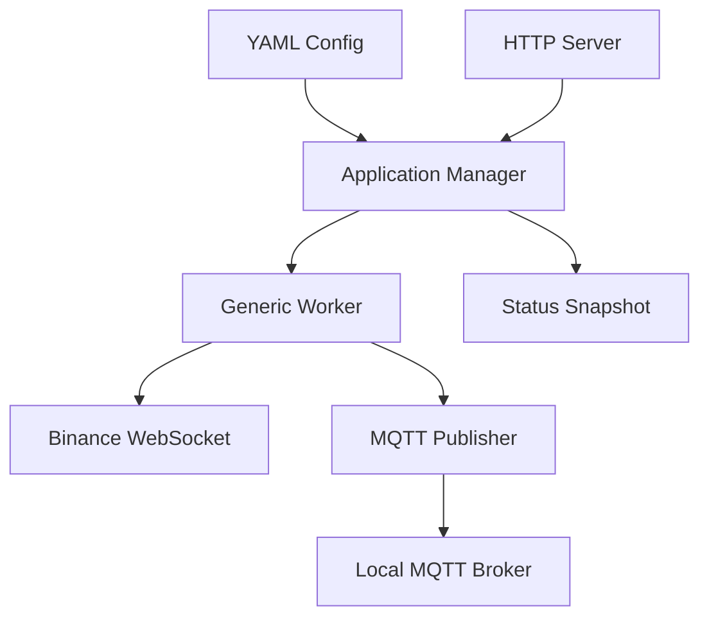

# Requirements

### Overview & Goals
Build a standalone, headless Java process that loads YAML configuration, connects to Binance USD-M Futures kline streams, publishes market and lifecycle data to local MQTT, and exposes local HTTP controls while remaining alive indefinitely.

### Scope
**In scope**
- Configurable Binance base URL, stream names, MQTT broker/topic settings, HTTP bind/port, and initial desired state (`start` or `stop`).
- Generic replaceable worker lifecycle with manager operations for start, stop, restart, status, uptime, and error reporting.
- Binance `btcusdt@kline_1m`, `ethusdt@kline_1m`, or any configured stream subscriptions.
- MQTT topics `live`, `candles`, and `logging`.
- Native Java HTTP endpoints for monitoring and control; no authentication or TLS.
- Automatic reconnect/error state handling and a forever-idling application process.

**Out of scope**
- Binance trading/order APIs, persistence/database storage, authentication, authorization, TLS, UI beyond HTTP/JSON endpoints, and Docker packaging in the initial implementation.

### Functional Requirements
- Parse Binance combined-stream messages and publish each kline update to `live`; publish a closed kline when Binance marks it final to `candles`.
- Publish socket/worker transitions, failures, and control actions to `logging`.
- Print concise console messages for application startup, HTTP server readiness, worker/socket transitions, errors, and each live or closed candle so the headless process can be monitored without MQTT or a browser.
- Throttle repeated MQTT connection-unavailable diagnostics so an outage does not flood the console.
- Print the Binance candle message received from the WebSocket as-is, using clearly different console messages for live and closed candles when live console output is enabled.
- Independently configure whether non-final live candles are printed to `System.out` and whether they are published to the MQTT `live` topic using the YAML keys `systemLog.liveCandles` and `mqtt.publishLiveCandles`; closed-candle output and publishing remain unchanged.
- Expose browser-friendly runtime endpoints to get and change both live-candle controls without restarting the process; runtime changes affect only subsequent non-final candles and do not alter closed-candle behavior.
- Respect configured initial state at startup and make stop safe to call repeatedly; stopping must disconnect or disable the stream worker without terminating the JVM.
- HTTP control must be usable when no browser is connected and must report current desired state, actual worker/socket state, uptime, last error, and stream information.
- Every existing HTTP endpoint (`/status`, `/start`, `/stop`, `/restart`) must accept both `GET` and `POST`, so browser address-bar navigation can perform controls without changing response semantics.
- The process must continue waiting indefinitely after startup and after worker failures; manager commands must not terminate the application.
- Repeated `restart` commands followed by `stop` must leave the worker stopped, disconnected, and unable to reconnect from stale asynchronous callbacks.

# Technical Design

### Current Implementation
The repository is a single Java Gradle module with the implementation already present. `src/main/java/nbgsmk/msr/Main.java` and `BinanceMarketWorker.java` already emit startup, lifecycle, error, and candle-monitoring output. `PahoMqttPublisher.java:27-55` reconnects asynchronously but prints a connection-unavailable diagnostic on every failed attempt, while `BinanceMarketWorker.java:82-98` parses each kline, publishes a reconstructed payload, and prints a reformatted summary instead of the original WebSocket JSON.

### Key Decisions
- Use a generic `Worker` lifecycle contract (`start`, `stop`, `restart`, status/error access) owned by an `ApplicationManager`; this directly supports replacing the Binance worker without changing manager control logic.
- Use the JDK WebSocket client for Binance and `com.sun.net.httpserver.HttpServer` for the native local HTTP API, avoiding a web framework.
- Use Eclipse Paho MQTT for broker connectivity and a YAML library such as Jackson YAML for typed configuration; these are new Gradle dependencies.
- Keep the manager as the lifecycle authority, with thread-safe state transitions and a dedicated worker executor; worker callbacks update observable status but never decide process termination.
- Keep runtime live-candle settings in a thread-safe mutable control object owned by `ApplicationManager`; initialize it from YAML and inject the settings view into `BinanceMarketWorker`, so HTTP updates are visible immediately without rebuilding the worker.
- Make MQTT availability non-fatal: do not require a successful constructor connection, reconnect asynchronously with bounded backoff, and record the last MQTT error without throwing through `Main`, HTTP handlers, or WebSocket callbacks.
- Treat each worker start/restart as a distinct connection generation so callbacks and reconnect tasks from an older socket cannot clear or replace the current socket after a later restart/stop.

### Proposed Changes
Create a configuration bootstrap that loads a default classpath YAML and optionally a configured external path, validates non-empty stream/topic/broker values, and supplies immutable settings to the manager. Refactor the MQTT publisher so broker refusal is captured as an unavailable state, reconnect occurs in the background, and publish attempts are safe while disconnected. The manager must construct the publisher, worker, and HTTP server, apply the initial state, and enter its keep-alive wait even when MQTT is unavailable.

Preserve the existing lightweight console logging and make live-candle visibility configurable: add explicit YAML-backed flags for live `System.out` output and live MQTT publishing. In `BinanceMarketWorker.handleMessage`, apply those flags only to non-final klines; retain closed-candle MQTT publishing and `CLOSED` raw JSON output. Logging must not throw, block WebSocket callbacks, or alter closed-candle routing.

Implement a `BinanceMarketWorker` that builds the combined-stream URL from the configured base URL and stream list, opens the WebSocket, parses kline payloads, reconnects after unexpected closure with bounded delay, and exposes `RUNNING`, `STOPPED`, `STARTING`, `STOPPING`, and `ERROR` status. Associate sockets and scheduled reconnects with a generation/token, ignore stale close/error/connect callbacks, cancel or invalidate pending reconnect work on stop, and ensure stop closes the currently active socket. Inject a `MqttPublisher` so worker logic is testable without a broker; publish structured JSON envelopes containing event type, symbol, interval, timestamps, OHLCV fields, final/closed flag, and error/status details as appropriate.

Implement HTTP handlers for JSON responses and control commands at `/status`, `/start`, `/stop`, and `/restart`, accepting both `GET` and `POST` for each path. Add a browser-friendly settings endpoint, such as `GET`/`POST /live-candles`, that returns both current flags and accepts query parameters `systemLog` and `mqtt` with boolean values. Preserve the existing JSON status/command responses and map unsupported methods, missing or invalid boolean parameters, and unknown settings to clear 4xx responses; internal failures remain 5xx responses. Keep the server independent of browser presence and shut it down only during JVM shutdown handling.

### Data Models / Contracts
- `Worker`: lifecycle and status abstraction usable by any replacement worker.
- `ApplicationManager`: `start()`, `stop()`, `restart()`, `status()`, `uptime()`, `lastError()`, and worker replacement through constructor injection.
- `AppConfig`: Binance URL/streams, MQTT broker/client/topics plus `publishLiveCandles`, HTTP host/port, initial desired state, reconnect settings, and the console live-candle control bound from `systemLog.liveCandles`.
- `WorkerStatus` and `ManagerStatus`: desired state, actual state, socket state, uptime, configured streams, last error, and timestamps.
- MQTT payload contracts: live kline event, closed candle event, and logging/status event serialized as JSON.
- Console output contract: informational lines identify startup/readiness, worker transitions, and visibly distinct `LIVE` versus `CLOSED` raw Binance candle messages when enabled; error lines identify MQTT, WebSocket, parsing, and shutdown failures without exposing credentials.
- Live-candle controls: `systemLog.liveCandles` controls raw `LIVE` console lines and `mqtt.publishLiveCandles` binds to `MqttConfig.publishLiveCandles` for publication to the configured `liveTopic`; both default to enabled when omitted.
- `MqttPublisher`: connection state and last error; broker refusal must not escape application startup or control requests.
- Runtime live-candle settings contract: thread-safe `systemLog` and `mqtt` booleans initialized from `AppConfig`, exposed in status/settings JSON, and updated atomically by the HTTP server; closed-candle routing/output ignores these flags.

### File Structure
- Modify `build.gradle.kts` with YAML, Paho, and JSON/test dependencies.
- Replace `src/main/java/nbgsmk/msr/Main.java` with bootstrap and shutdown-hook wiring.
- Add configuration classes under `src/main/java/nbgsmk/msr/config/` and a sample `src/main/resources/application.yml`.
- Add worker abstractions and Binance implementation under `src/main/java/nbgsmk/msr/worker/`.
- Add MQTT publisher and payload models under `src/main/java/nbgsmk/msr/mqtt/` and `model/`.
- Add manager/status classes under `src/main/java/nbgsmk/msr/manager/`.
- Add native HTTP server/handlers under `src/main/java/nbgsmk/msr/http/`.
- Add unit tests under `src/test/java/nbgsmk/msr/` for configuration, lifecycle, parsing, publishing, and HTTP control.

### Architecture Diagram

### Risks
- Binance disconnects and malformed messages require reconnect and defensive parsing without killing the process.
- Concurrent HTTP commands require serialized lifecycle transitions and idempotent start/stop behavior.
- MQTT broker outages must update status/logging and retry without blocking WebSocket message handling; unavailable logging must not create recursive failure loops.
- Startup ordering must not make the local MQTT broker a prerequisite for the HTTP control surface or JVM.
- External YAML paths and environment/container deployment may need a documented override mechanism even though Docker packaging is deferred.

# Testing

### Validation Approach
Use JUnit tests with mocked/fake WebSocket and MQTT interfaces, plus an in-process HTTP server/client where practical. Build the Gradle project and verify the application entry point, lifecycle behavior, and serialization without requiring live Binance or MQTT services.

### Key Scenarios
- YAML loads configured streams, topics, initial state, and server settings; invalid required values fail with actionable errors.
- Worker start opens the configured combined stream even when MQTT is unavailable; kline events use the documented offline publish policy and resume publishing after reconnection.
- Startup and HTTP readiness produce console messages, worker transitions are visible, and non-final and final kline messages print the original JSON with different `LIVE` and `CLOSED` console messages.
- Stop/restart are idempotent and update manager status/logging without terminating the process.
- WebSocket closure/error causes an error status and reconnect attempt; MQTT refusal is reflected in status without failing `Main`, and reconnect resumes publishing.
- Both `GET` and `POST` requests to `/status` return uptime and state, while both methods on `/start`, `/stop`, and `/restart` invoke the manager and return appropriate results.
- The live-candle settings endpoint returns current `systemLog` and MQTT publication values, accepts valid browser-friendly updates, rejects missing/invalid values, and subsequent live klines follow the new settings without restart; closed klines remain printed and published.

### Edge Cases
- Empty or duplicate streams, malformed Binance JSON, unknown event types, repeated commands, connection failure before startup, MQTT unavailable at startup, MQTT loss after connection, publish during reconnect, and shutdown while reconnecting.
- Verify console logging remains safe for malformed/error messages and does not terminate the process.
- Verify the main process remains alive after worker stop and after recoverable errors.
- Exercise several consecutive restarts followed by stop and verify the worker remains `STOPPED`, `socketState` remains `DISCONNECTED`, and no stale reconnect callback starts a new connection.
- Exercise runtime live-candle reads and updates through both accepted HTTP methods, invalid boolean values, independent flag combinations, and closed-candle behavior after each combination.

# Delivery Steps

### ✓ Step 1: Establish configuration and generic lifecycle foundation
A typed YAML configuration and replaceable worker manager provide the application’s lifecycle foundation.
- Add Gradle dependencies for YAML/JSON handling, MQTT, and test support.
- Add `AppConfig` loading/validation and a sample `application.yml` for Binance streams, MQTT, HTTP, reconnect, and initial state.
- Define `Worker`, status models, and `ApplicationManager` with thread-safe start/stop/restart, uptime, error tracking, and shutdown-hook integration.
- Add unit coverage for configuration validation and idempotent manager transitions.

### ✓ Step 2: Implement Binance stream worker and MQTT publishing
The market worker connects to Binance USD-M combined kline streams while MQTT availability is optional, publishing events whenever connected without allowing broker refusal to stop the process.
- Refactor `PahoMqttPublisher` so construction does not synchronously fail when the broker is down.
- Add bounded asynchronous reconnect, connection-state/last-error tracking, safe offline publishing, and non-recursive lifecycle logging.
- Implement Binance WebSocket URL construction, message parsing, final-candle classification, reconnect behavior, and worker state callbacks.
- Serialize structured JSON payloads for `live`, `candles`, and `logging`.
- Test parsing, final versus non-final routing, publish failures, broker refusal at construction, reconnect/error transitions, and worker/HTTP usability with an offline publisher.

### ✓ Step 3: Add native HTTP monitoring and control
A local headless HTTP API can monitor and control the manager independently of browser connections.
- Implement `HttpServer` routing for status and start/stop/restart commands.
- Return JSON status snapshots with desired/actual state, uptime, streams, socket state, and last error.
- Handle invalid commands and internal failures with consistent HTTP status responses.
- Test endpoint behavior against a fake worker/manager and verify commands remain safe when repeated.

### ✓ Step 4: Wire the standalone forever-running application
Running `Main` starts the configured manager and HTTP server, applies the initial desired state, and never exits during normal operation even when the configured MQTT broker is unavailable.
- Replace the starter `Main.java` stub with bootstrap wiring for config, manager, worker, MQTT, and HTTP components.
- Ensure MQTT, worker, and server failures are surfaced through status/logging rather than terminating the JVM; verify `Main` reaches its keep-alive wait when `localhost:1883` refuses the connection.
- Add an indefinite idle/wait loop and JVM shutdown cleanup.
- Build and run the Gradle test suite to validate the complete local lifecycle without requiring Docker or a running MQTT broker.

### ✓ Step 5: Add console monitoring for runtime and candle activity
The headless process prints actionable startup, lifecycle, error, and candle summaries to the console without changing existing MQTT or HTTP behavior.
- Add `System.out` messages in `Main.java` for configuration/startup, HTTP readiness, initial state application, and shutdown.
- Add `System.out`/`System.err` messages in `BinanceMarketWorker.java` for worker transitions, reconnect attempts, WebSocket/parser failures, and MQTT-independent errors.
- Print compact `LIVE` and `CLOSED` candle summaries from the existing parsed kline path, including symbol, interval, close price, and relevant timestamps.
- Keep console formatting defensive and non-sensitive, and verify logging with fake publisher/message inputs plus an offline startup run.

### ✓ Step 6: Reduce MQTT outage noise and print raw Binance candles
MQTT outages produce at most one connection-unavailable diagnostic per configured throttle window, and candle monitoring prints each received Binance JSON message unchanged.
- Update `PahoMqttPublisher` to retain the timestamp of the last connection-unavailable diagnostic and suppress duplicate messages until the throttle interval elapses, while preserving background reconnect attempts and `lastError` tracking.
- Keep publish-failure handling and MQTT routing behavior unchanged; only repeated console diagnostics are suppressed.
- Update `BinanceMarketWorker.handleMessage` to print the original WebSocket `message` after validating it as a kline, with a `LIVE` or `CLOSED` label if needed, and remove the reconstructed formatted candle summary.
- Extend worker/publisher-focused tests to verify raw JSON visibility and that repeated failed connection attempts do not emit an unbounded stream of identical diagnostics.

### ✓ Step 7: Distinguish closed-candle console output
Closed candle notifications are visibly different from live candle notifications while retaining the raw Binance JSON.
- Update the `closed` branch in `BinanceMarketWorker.handleMessage` so its `System.out` message uses an explicit closed-candle label distinct from the live-candle label.
- Preserve the existing `k.x` classification, MQTT topic routing, payload format, and raw message content.
- Extend `BinanceMarketWorkerTest` to capture output for both non-final and final kline messages and assert that their console labels differ.

### ✓ Step 8: Allow GET and POST for all HTTP endpoints
The browser can use either address-bar `GET` requests or `POST` requests for status and lifecycle controls without changing the API responses.
- Update `ControlHttpServer` method validation so `/status`, `/start`, `/stop`, and `/restart` accept `GET` and `POST`.
- Keep manager invocation, JSON payloads, status codes for successful commands, and unsupported-method handling unchanged.
- Extend `ControlHttpServerTest` with HTTP-level checks for both verbs on status and lifecycle endpoints, including repeated/idempotent commands and rejection of an unrelated method.

### ✓ Step 9: Make repeated restart and stop lifecycle-safe
After repeated restarts, a stop command leaves the Binance worker stopped and disconnected with no stale asynchronous callback able to revive it.
- Update `BinanceMarketWorker` lifecycle coordination so every start/restart creates a new connection generation and stop invalidates the current generation.
- Associate `WebSocket.Listener` callbacks and scheduled reconnect tasks with their generation; ignore callbacks from old sockets and prevent them from nulling or replacing the current socket.
- Cancel or invalidate pending reconnect attempts during stop, and close the socket belonging to the active generation before reporting `STOPPED`.
- Add focused worker/manager tests using controllable fake sockets or callbacks for repeated restart sequences followed by stop, asserting stable `STOPPED`/`DISCONNECTED` state and no reconnect after stop.

### ✓ Step 10: Make live-candle output and MQTT publication configurable
`application.yml` can independently disable live-candle console lines and/or MQTT `live` publication without affecting closed candles.
- Extend `AppConfig` and `ConfigLoader` binding with the YAML keys `systemLog.liveCandles` and `mqtt.publishLiveCandles`, defaulting to `true` when omitted.
- Add `systemLog.liveCandles: true` and `mqtt.publishLiveCandles: true` to `src/main/resources/application.yml` and document that `false` suppresses only non-final live klines.
- Update `BinanceMarketWorker.handleMessage` to conditionally publish the reconstructed live payload and conditionally print the original raw `LIVE` message; always preserve closed-candle publication and `CLOSED` output.
- Add focused tests for all four flag combinations, asserting live topic/output behavior and unchanged closed-candle behavior; retain existing defaults for current deployments.

### ✓ Step 11: Move live MQTT publication configuration under the MQTT section
The YAML contract uses `mqtt.publishLiveCandles`, and the Java MQTT configuration model exposes the renamed setting.
- Move `mqttPublishLiveCandles: true` under `mqtt:` in `src/main/resources/application.yml` and rename it to `publishLiveCandles`.
- Move the Boolean field from the top-level `AppConfig` record into `AppConfig.MqttConfig`, defaulting it to `true` when omitted.
- Update `BinanceMarketWorker` to read `config.mqtt().publishLiveCandles()` while preserving closed-candle publication regardless of the flag.
- Update all `AppConfig` constructors, YAML binding expectations, and worker tests to use the nested MQTT property.
- Add or adjust configuration tests to verify the nested key loads correctly and the old root-level key is no longer required.

### ✓ Step 12: Add runtime controls for live-candle console and MQTT output
The running service exposes browser-friendly controls that independently toggle live console output and live MQTT publication without restarting.
- Add a thread-safe runtime settings holder initialized from `AppConfig.systemLog.liveCandles` and `AppConfig.mqtt.publishLiveCandles`.
- Update `ApplicationManager`, `BinanceMarketWorker`, and the HTTP layer so worker message handling reads the current settings for each kline.
- Add `GET`/`POST /live-candles` returning both current values and accepting boolean query parameters for `systemLog` and `mqtt`.
- Preserve existing lifecycle endpoints and ensure closed candles are always printed and published.
- Add tests for reads, independent updates, invalid requests, both HTTP verbs, and behavior changes on subsequent live messages.

### ✓ Step 13: Preserve YAML defaults while keeping browser controls runtime-only
The YAML values remain permanent startup configuration, while `/live-candles` changes affect only the current JVM and never rewrite `application.yml`.
- Keep `mqtt.publishLiveCandles` and `systemLog.liveCandles` in `src/main/resources/application.yml` and bind them as startup defaults.
- Ensure `LiveCandleSettings` is the only mutable runtime state used by the worker and HTTP endpoint; do not serialize or persist endpoint updates.
- Clarify `/live-candles` responses and documentation as runtime overrides, with a process restart reloading the YAML values.
- Add tests that update both flags through HTTP, verify the running worker uses the overrides, and verify the YAML resource/configuration remains unchanged and defaults are restored by a fresh configuration load.

### ✓ Step 14: Restore Binance startup wiring and make output configuration worker-agnostic
`Main.java` runs the original Binance MQTT worker again, while YAML and Java configuration names describe generic message streams and runtime output rather than candle-specific concepts.
- Restore `Main.java` imports and construction for `PahoMqttPublisher` and `BinanceMarketWorker`; retain the shared `LiveCandleSettings`, HTTP server, shutdown hook, initial-state application, and keep-alive behavior.
- Replace the current candle-specific MQTT names with a worker-agnostic naming set. Recommended option: `mqtt.liveTopic` → `mqtt.realtimeTopic`, `mqtt.candlesTopic` → `mqtt.completedTopic`, and `mqtt.publishLiveCandles` → `mqtt.publishRealtimeUpdates`; retain `mqtt.loggingTopic` because it already describes a generic diagnostic channel.
- Replace `systemLog.liveCandles` with `systemLog.realtimeUpdates`, matching the recommended runtime/output terminology.
- Preserve the existing topic routing semantics: non-final worker updates use the realtime topic, final/completed updates use the completed topic, and completed updates remain always published and logged.
- Also document these alternatives for review before implementation: `dataTopic`/`completedDataTopic` with `publishLiveUpdates`, or `updatesTopic`/`completedUpdatesTopic` with `publishUpdates`; choose one consistent vocabulary rather than mixing names.
- Update `AppConfig`, `ConfigLoader` binding expectations, `LiveCandleSettings`, `BinanceMarketWorker`, tests, and `application.yml` together; do not support both old and new keys unless backward compatibility is explicitly requested.
- Add regression coverage proving `Main` selects `BinanceMarketWorker`, renamed YAML defaults load correctly, runtime `/live-candles` behavior remains equivalent under the renamed settings, and closed updates remain unaffected.

### ✓ Step 15: Add a separate DummyWorker application entry point
`Main2.java` provides a simple runnable example that uses the existing generic manager and `DummyWorker`, while the production `Main.java` remains unchanged.
- Copy the current `Main.java` bootstrap structure into `src/main/java/nbgsmk/msr/Main2.java` with class and constructor names changed appropriately.
- Replace only the production worker wiring in `Main2` with `nbgsmk.msr.example.DummyWorker`; retain configuration loading, shared runtime settings, HTTP controls, initial-state handling, keep-alive behavior, and shutdown cleanup.
- Do not modify `src/main/java/nbgsmk/msr/Main.java` or its Binance/MQTT wiring.
- Verify that `Main2` can start with the configured initial state, prints the dummy worker’s periodic simulated work, responds to the existing HTTP lifecycle endpoints, and stops cleanly through shutdown handling.

### ✓ Step 16: Plug the MQTT publisher into the DummyWorker example
`Main2.java` mirrors `Main.java`'s bootstrap and service wiring, replacing only `BinanceMarketWorker` with `DummyWorker` while still creating and managing the configured `PahoMqttPublisher`.
- Import `PahoMqttPublisher` in `Main2.java` and construct it from `config.mqtt().broker()` and `config.mqtt().clientId()` before creating the manager.
- Keep `DummyWorker` as the worker implementation and preserve the existing manager, HTTP controls, initial-state, keep-alive, and runtime-settings behavior.
- Close the publisher from the shutdown hook, alongside the HTTP server, manager, and dummy worker, so its reconnect executor and Paho client do not remain alive.
- Verify that `Main2` remains running when the MQTT broker is unavailable, continues printing dummy work, and performs publisher cleanup on shutdown.

### ✓ Step 17: Publish dummy messages from DummyWorker to configured MQTT topics
`Main2`'s dummy worker will exercise the configured MQTT integration by publishing deterministic sample payloads to all three configured topics on each five-second work cycle, without changing production Binance behavior.
- Update `src/main/java/nbgsmk/msr/example/DummyWorker.java` to accept an injected `MqttPublisher` and the configured `AppConfig.MqttConfig` (or equivalent topic values), while retaining the existing `Worker` lifecycle contract.
- In `doWork()`, publish a small JSON dummy payload to `realtimeTopic`, `completedTopic`, and `loggingTopic`; keep the console work message and handle publish/runtime failures through the worker’s existing error reporting.
- Update `src/main/java/nbgsmk/msr/Main2.java` to construct the worker with the already-created `PahoMqttPublisher` and MQTT configuration; keep `Main.java` and `BinanceMarketWorker.java` unchanged.
- Add focused tests using a fake `MqttPublisher` to verify all three configured topics receive messages, scheduled work remains lifecycle-controlled, and publisher failures do not terminate the application.

### Testing for Step 17
- Verify the dummy worker publishes once per scheduled cycle to `realtimeTopic`, `completedTopic`, and `loggingTopic` with non-empty deterministic JSON payloads.
- Verify `stop()` prevents subsequent dummy publications and `close()` releases the worker scheduler; verify repeated lifecycle calls remain safe.
- Verify `Main2` uses the YAML values `liveCandles`, `closedCandles`, and `logging` through `AppConfig`, while `Main` remains wired to Binance.

### ✓ Step 18: Rename the runtime live-update control endpoint
The browser-facing runtime settings endpoint is renamed from `/live-candles` to the worker-agnostic `/live-updates`, while its query controls and runtime-only behavior remain unchanged.
- Update `ControlHttpServer` to register `/live-updates` and route it to the existing live-update settings handler.
- Keep `GET` and `POST` support, `systemLog` and `mqtt` query parameters, JSON response fields, validation behavior, and closed-update semantics unchanged.
- Replace candle-specific invalid-parameter wording with `/live-updates`-appropriate wording.
- Update `ControlHttpServerTest` to use `/live-updates` for status, updates, invalid parameter, and boolean validation requests.
- Do not retain `/live-candles` as an alias unless backward compatibility is requested; update endpoint documentation/comments in the plan to use `/live-updates`.