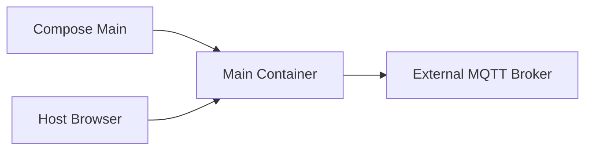

# Requirements

### Overview & Goals
Make the Docker Compose deployment of production `Main` observable and reliably reachable while it connects to an external MQTT broker. Preserve the existing Binance/MQTT behavior and keep `Main2` excluded.

### Scope
**In scope**
- Make container startup progress visible in `docker compose logs -f`.
- Ensure HTTP readiness is checked only after the server is actually listening.
- Add Compose health/readiness configuration and correct smoke-test documentation.
- Preserve non-fatal MQTT outage handling and external broker configuration.

**Out of scope**
- Adding an MQTT broker container, changing Binance stream behavior, or redesigning the worker architecture.

### Functional Requirements
- `docker compose -f docker-compose.yml up --build` starts the Binance application and connects it to the configured external MQTT broker.
- `Main2` is not containerized or included in the Compose workflow.
- The application uses a configurable MQTT hostname/address rather than assuming `localhost`; the app remains alive if MQTT is temporarily unavailable.
- Host users can access the HTTP control API on a documented port and inspect application logs with Compose commands.
- Configuration remains YAML-based, with one shared `src/main/resources/application.yml` used by IntelliJ and Docker.
- The MQTT broker endpoint and HTTP bind host are configurable through environment overrides, supporting local defaults and container/external-network deployment without a second YAML file.
- The MQTT broker endpoint is configurable independently of the image, supporting a Podman-published host address, a fixed external IP/DNS name, or another reachable network endpoint.
- Container shutdown propagates cleanly to the existing JVM shutdown hooks; the application restart policy applies to process/container failure rather than worker lifecycle commands.

# Technical Design

### Current Implementation
The project is a single Gradle Java module using `build.gradle.kts`, Jackson YAML, Eclipse Paho, the JDK WebSocket client, and native `HttpServer`. `Main.java` wires `PahoMqttPublisher`, `BinanceMarketWorker`, `ApplicationManager`, and `ControlHttpServer`. `Main2.java` is a test-only dummy entry point and is excluded from this Docker work. `ConfigLoader` loads the bundled `src/main/resources/application.yml` or an optional external path and expands `${NAME:-default}` placeholders before YAML parsing. The current local and Docker YAML files duplicate the same settings but differ in MQTT broker and HTTP host defaults.

`BinanceMarketWorker` keeps one reusable JDK `HttpClient`, reconnects generation-safely, publishes configured realtime/completed/logging topics, and does not require the broker to be available at startup. This behavior should remain unchanged; Dockerization supplies container-specific configuration and networking only.

### Key Decisions
- Use one shared application `Dockerfile` and one `docker-compose.yml`; do not containerize or include `Main2`.
- Use a lightweight JRE runtime image after a Gradle builder stage; run the packaged application as a non-root user where practical.
- Keep the broker external to Compose and make the complete MQTT URI overridable at deployment time, preferably through an environment-substituted Compose/config value such as `MQTT_BROKER`; do not add any broker service.
- Document that Docker-to-Podman connectivity requires the Podman broker to publish port `1883` on a host-reachable interface, or requires the application to use the host’s fixed IP/DNS address; `host.docker.internal` is only a convenience route and is not a cross-runtime network bridge.
- Use one shared `src/main/resources/application.yml` for IntelliJ and Docker; remove the Docker-only YAML mount and rely on Compose environment variables for deployment-specific values.
- Expose the application HTTP port; expose an MQTT port only when host-side access to the existing broker requires it, not as a broker container port.
- Retain the worker’s asynchronous MQTT reconnect behavior because broker availability is external to the Compose lifecycle.

### Proposed Changes
Add explicit startup diagnostics around configuration loading, MQTT publisher creation/connection attempts, HTTP server startup, and initial worker state so container logs prove where startup reaches. Avoid allowing the synchronous MQTT connection attempt to obscure HTTP readiness: either move initial MQTT connection/retry off the main startup path or otherwise bound its startup impact while retaining the existing asynchronous reconnect behavior.

Add a Compose healthcheck that polls `GET /status` after the HTTP server is listening, with a startup grace period and retries suitable for image startup. Keep the service restart policy for process failures only, and update `docker-compose.md` to wait for `healthy`, inspect logs/status, and distinguish an MQTT connectivity issue from an HTTP startup issue.

Do not add Mosquitto configuration, broker volumes, broker health checks, or a second Compose stack. Document the required network reachability from the application container to the MQTT broker on the historical PC.

Add concise deployment documentation covering build/start commands for `Main`, external MQTT host configuration, HTTP checks (`/status` and `/live-updates`), application logs, shutdown, and cleanup. Document environment-based broker and HTTP-host selection with examples for IntelliJ, Docker, a Podman broker published on the host, and a fixed external IP/DNS endpoint. Add smoke validation that confirms the application starts, remains running, reaches the configured broker address, and exposes its HTTP API.

### File Structure
- Add `Dockerfile` for the shared multi-stage Java build/runtime image.
- Add `docker-compose.yml` for `Main` only, without an MQTT broker service.
- Update `src/main/resources/application.yml` with shared defaults and `${MQTT_BROKER:-...}` / `${HTTP_HOST:-...}` overrides.
- Remove the redundant `docker/config/main/application.yml` and its Compose volume mount.
- Add `docker-compose.md` documenting external broker prerequisites, commands, ports, and smoke checks.
- Keep `src/main/java/nbgsmk/msr/Main.java` and `BinanceMarketWorker.java` behavior unchanged unless a small packaging-compatible adjustment is required; do not modify `Main2.java`.

### Architecture Diagram

### Risks
- A synchronous MQTT connection attempt before HTTP startup can make the container appear hung or fail an immediate curl check; bound or asynchronous connection startup and explicit milestones mitigate this.
- Docker log output can be misleading if startup fails before the first application message; print milestones before external connections and retain stack traces for fatal bootstrap errors.
- Binding HTTP to `127.0.0.1` inside a container would make the API unreachable from the host; the production YAML must use `0.0.0.0`.
- Using `localhost` for MQTT would make the application connect to its own container; the external broker address must be configurable and reachable from the container network.
- Docker and Podman use separate network namespaces by default; a Podman broker may be unreachable through Docker’s gateway unless its port is published and its listener/firewall permits the host route. Prefer an explicit fixed host/external IP or DNS value when cross-runtime routing is required, and verify it from inside the app container.
- Image builds depend on downloading Gradle/Maven dependencies; document offline limitations and keep runtime startup independent of the build environment.

# Testing

### Validation Approach
Build the image with Docker Compose, start the production application, inspect its health and logs, and query the exposed HTTP API from the host. Run existing Gradle tests separately and perform smoke checks without requiring live Binance data beyond the worker’s normal reconnect behavior.

### Key Scenarios
- `docker compose -f docker-compose.yml config` renders a valid Compose configuration containing only the production application service.
- The image builds successfully and starts `Main` without a broker service in the Compose project.
- `GET /status` returns a valid response; `/start`, `/stop`, `/restart`, and `/live-updates` remain reachable.
- Application logs and status show that MQTT uses the configured external broker address rather than `localhost`, and the process remains alive while MQTT is unavailable or restarted.
- Stopping the Compose application triggers clean JVM shutdown handling.

### Edge Cases
- The external broker starts slowly, restarts after application startup, or is temporarily unavailable.
- The external configuration mount is absent, malformed, or contains an invalid broker host/port; startup reports a clear error.
- The application container cannot route to the broker because it is not on a shared Docker network or the broker address is unreachable.
- The host HTTP port is already occupied; Compose reports the binding failure clearly.

# Delivery Steps

### ✓ Stage 1: Add the production Java container image
The project produces a small runnable image for `Main`; `Main2` remains outside the Docker workflow.
- Add the multi-stage `Dockerfile` using the Gradle wrapper for the build stage and a compatible JRE runtime stage.
- Copy the built JAR into the runtime image and define a non-root runtime user where supported.
- Launch the packaged `nbgsmk.msr.Main` entry point with `--config /config/application.yml`.
- Verify the image builds and the production process starts without changing application code.

### ✓ Stage 2: Create the Compose stack for Main and the external historical-PC MQTT broker
The Binance application runs reproducibly with only its application container while connecting to the MQTT broker already running on the historical PC.
- Add `docker-compose.yml` with one application service, restart policy, HTTP port mapping, and configuration for reaching the historical-PC broker; do not define an MQTT broker service.
- Add the production container YAML override with `mqtt.broker` set to the externally reachable broker address and `http.host: 0.0.0.0`.
- Do not define Mosquitto, broker volumes, broker health checks, or `Main2` services.
- Launch `Main` with `--config /config/application.yml` and verify broker outages remain non-fatal through the existing reconnect behavior.

### ✓ Stage 3: Make container startup observable and non-blocking
The container reaches HTTP readiness independently of temporary MQTT broker availability, with clear startup milestones in Compose logs.
- Adjust `PahoMqttPublisher`/`Main` startup sequencing so an unavailable broker cannot hide or indefinitely delay HTTP server readiness.
- Add explicit console diagnostics for configuration, MQTT attempt/failure, HTTP readiness, and initial worker state.
- Add focused tests proving startup remains available when MQTT connection fails and diagnostics are emitted without terminating the process.

### ✓ Stage 4: Add Compose readiness validation and correct operational documentation
The documented Compose workflow waits for and verifies the actual HTTP readiness state.
- Add a Compose healthcheck for `/status`, with `start_period`, interval, timeout, and retries.
- Update `docker-compose.md` commands to use the current `docker-compose.yml`, inspect health, follow logs, and wait before curling endpoints.
- Validate `docker compose config`, image build, healthy startup, `/status`, MQTT-unavailable survival, and clean shutdown.

### ✓ Stage 5: Diagnose container-to-broker and startup-delay behavior
The deployment identifies whether the one-minute delay and missing MQTT messages come from broker routing, MQTT connection state, Binance connectivity, or readiness timing.
- Add or document startup timestamps and explicit MQTT connection success/failure state in the container logs and `/status` output without making broker availability fatal.
- Verify the mounted broker address, DNS resolution, TCP reachability to port `1883`, and broker-side client visibility from the running container.
- Compare `docker logs`, `/status`, and worker socket state to distinguish MQTT failure from Binance WebSocket/DNS delay.
- Keep the external broker model unchanged; do not add a broker service or alter `Main2`.

### ✓ Stage 6: Apply the targeted container networking/readiness correction
The container reaches a clear ready state promptly and publishes to the external broker when the configured route is reachable.
- Correct the Compose/YAML broker hostname or shared-network/host-gateway settings if diagnostics show the current `host.docker.internal` route is invalid for the broker location.
- Ensure readiness reflects HTTP availability separately from MQTT and Binance operational state, while reporting both states clearly.
- Add focused smoke validation for broker reachable, broker unavailable, delayed broker, and delayed Binance scenarios.
- Update `docker-compose.md` with the exact container-side connectivity checks and expected log/status evidence.

### ✓ Stage 7: Make Docker-to-Podman and fixed external broker routing configurable
The production Compose deployment can select a reachable external MQTT URI without rebuilding the image or editing application code.
- Add deployment-time broker URI substitution/override for the mounted container configuration, with the current host-gateway URI retained only as a documented default.
- Update `docker-compose.yml` and `docker/config/main/application.yml` so operators can provide a Podman-published host address or a fixed external IP/DNS endpoint through an environment variable.
- Document Podman requirements: publish `1883`, bind the broker to a host-reachable interface, allow the Docker host/container source through firewall rules, and use the host’s fixed address when `host.docker.internal` does not route.
- Add commands to verify DNS and TCP reachability from the application container and explain that `curl` may fail at the MQTT protocol layer after TCP succeeds.
- Validate both a reachable external broker route and an unavailable route, confirming `/status` remains available and MQTT reconnect behavior remains non-fatal.

### ✓ Stage 8: Consolidate IntelliJ and Docker configuration into one YAML
Both local and container runs use `src/main/resources/application.yml`, while Compose supplies only environment-specific overrides.
- Change the shared YAML broker value to `${MQTT_BROKER:-tcp://localhost:1883}` and HTTP host to `${HTTP_HOST:-127.0.0.1}`; retain common Binance, MQTT topic, port, state, reconnect, and logging settings.
- Update `docker-compose.yml` to pass `MQTT_BROKER` and `HTTP_HOST=0.0.0.0`, and remove the `/config/application.yml` volume because the packaged resource is now authoritative.
- Keep `ConfigLoader` environment expansion as the deployment mechanism and ensure Docker uses its configured broker endpoint through Compose environment defaults.
- Remove the redundant `docker/config/main/application.yml` and update `docker-compose.md` to explain local defaults versus Compose overrides.
- Validate IntelliJ startup with no environment variables, Docker startup with Compose overrides, `/status` reachability, and external MQTT routing.
